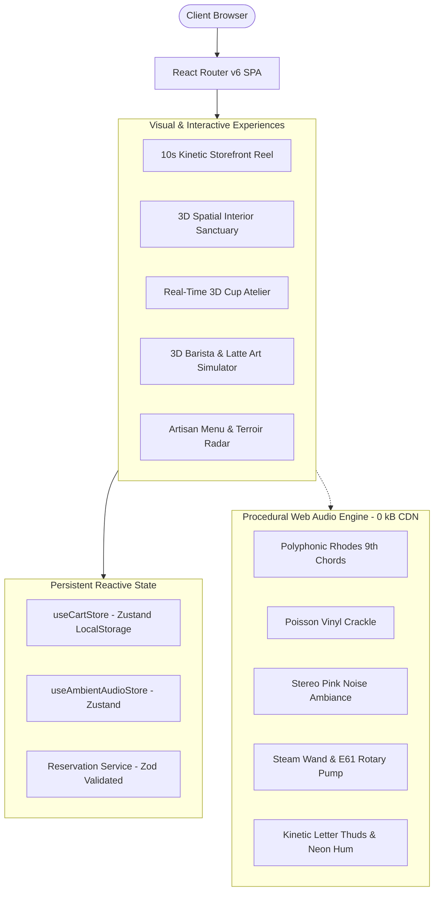

# AURA ROAST — Architectural Specification & Engineering Blueprint

> **Agency**: AesthenixTech  
> **Brand**: AURA ROAST  
> **Tagline**: *"Where Every Sip Becomes an Experience."*  
> **Version**: 2.0 Production Release  

---

## 1. Executive Architecture Summary

**AURA ROAST** is an ultra-premium, interactive 3D digital café experience engineered for high-performance web presentation. Rather than relying on generic e-commerce templates or bloated static 3D models, AURA ROAST features a modular procedural WebGL architecture, 100% procedural Web Audio synthesis, interactive real-time simulators, and enterprise-grade state management.



---

## 2. Core Technological Innovations

### 2.1 Photoreal 10-Second Storefront Reel & Director Timeline
- **File**: `src/components/three/StorefrontModel.tsx` & `src/scenes/Storefront/StorefrontScene.tsx`
- **Architectural Facade**: Royal Cobalt Blue facade (`#1D3E77`) with crown mouldings, fluted pilasters, granite sidewalk slabs, and clear ground-floor plate-glass window ($0.96$ transmission).
- **Kinetic Letter Stagger**: 8 procedural 3D block letters (`C-a-f-é R-i-g-o` or `C-a-f-é A-U-R-A`) fly in along randomized 3D trajectory vectors with an elastic landing recoil function:
  $$y(t) = 2^{-10t} \cdot \sin\left(\frac{2\pi(t - 0.075)}{0.3}\right)$$
- **2-Part Stacking Emblem**: Lower saucer plate and upper steam cup drop from above, stack with mechanical latch click, and trigger a $45^\circ$ diagonal specular glint sweep.
- **Illuminated Interior Glimpse**: Ground-floor window displays glowing pendant globes, wooden barista counter, espresso machine, and blue blackboard menu.
- **Director HUD**: Real-time 0–10s timeline scrubber slider, Phase HUD badges, Daylight/Blue Hour environment toggle, Brand Switcher, and Camera Push-In toggle.

---

### 2.2 Interactive 3D Barista Extraction & Latte Art Simulator
- **File**: `src/components/three/BaristaStationModel.tsx` & `src/scenes/BaristaStation/BaristaStationScene.tsx`
- **Commercial Espresso Rig**: Procedural E61 brass grouphead, dual analog hydraulic pressure and temperature gauges, 58mm walnut portafilter, and rotary pump audio synthesis.
- **Crema & Extraction Dynamics**: Animated extraction stream transitions from dark initial drip to thick golden hazelnut crema, rising volumetrically in the demitasse cup.
- **Dynamic HTML5 Canvas Latte Art**: Real-time procedural canvas textures supporting:
  - *Heart* (Concentric cardiod hearts with contrast crema ring)
  - *Rosetta* (Multi-tier undulating fern leaf with tapered stem)
  - *Tulip* (3 stacked layered foam bulbs with cutting draw)
- **SCA Sensory Scoring Engine**: Calculates live extraction score (e.g. 96.5/100) based on flow rate, pre-infusion duration, extraction pressure, and milk microfoam temperature.

---

### 2.3 Procedural Lo-Fi Café Soundscape (0 kB Bandwidth)
- **File**: `src/utils/ambientAudio.ts` & `src/components/audio/AmbientSoundscapePlayer.tsx`
- **Polyphonic Rhodes 9th Synthesizer**: Generates smooth jazz chords (`Cmaj9`, `Am9`, `Dm9`, `G13`, etc.) using additive dual-sine oscillators with frequency modulation (FM) tines, bell transients, and stereo ping-pong tremolo.
- **Acoustic Ambiance Layers**:
  - *Pink Noise Room Generator*: Filtered noise approximating distant café murmur.
  - *Poisson Vinyl Crackle*: Realistic needle pops and subtle vinyl static.
  - *Espresso Foley*: Automated steam wand hisses and ceramic clinks every 12–25 seconds.
- **Vibe Presets**:
  - *Midnight Rhodes*: Deep, reflective minor 9th progressions.
  - *Rainy Shibuya*: Warm, mellow chords with resonant tape filter.
  - *Milanese Roast*: Energetic, bright boutique roastery chords.
- **UI Visualizer**: Floating acrylic acoustic pill with 5-band spectrum audio equalizer, volume slider, and persistent Zustand state.

---

### 2.4 Real-Time 3D Cup Atelier & Customizer
- **File**: `src/components/three/CupCustomizerModel.tsx` & `src/scenes/CupCustomizer/CupCustomizerScene.tsx`
- **PBR Ceramic Glaze Finishes**:
  - *Terracotta Earth* (Roughness 0.65, warm earthen tone)
  - *Obsidian Matte* (Roughness 0.78, deep volcanic graphite)
  - *Imperial Porcelain* (Roughness 0.12, high specular clear glaze)
  - *Antique 24K Gold* (Roughness 0.22, metalness 0.95, radiant gold)
  - *Royal Cobalt* (Roughness 0.18, deep French blue glaze)
- **Volumetric Sizing**: Demitasse (80 ml), Tulip (220 ml), Grand Bowl (380 ml).
- **Artisanal Toppings**: Microfoam Crema, Cinnamon & Nutmeg Dust, 24K Edible Gold Leaf, Fleur de Sel Caramel Drizzle.
- **Saucer Coordination**: Matching Ceramic, Carrara Marble, Dark Walnut, Brushed Brass.
- **Direct Cart Integration**: Live price calculation engine that dispatches bespoke configurations directly into the global shopping cart.

---

### 2.5 Live Barista Order Tracker & Terroir Flavor Radar
- **Live Barista Order Tracker** (`src/components/cart/CartDrawer.tsx`): 4-phase preparation tracker with live progress meter, order code `#AURA-XXXX`, station designations, and customer pickup confirmation.
- **Terroir Flavor Radar** (`src/components/menu/FlavorRadarChart.tsx`): 5-axis SVG radar polygon (Acidity, Body, Sweetness, Aroma, Finish) plotted against the Specialty Coffee Association (SCA) 100-point cupping matrix.

---

## 3. Tech Stack & Library Specifications

| Layer | Library / Engine | Purpose |
|---|---|---|
| **Framework** | React 18.3 + TypeScript 5.5 | Type-safe declarative component architecture |
| **Build Tool** | Vite 5.4 | Sub-second HMR and production bundle optimization |
| **Routing** | React Router v6 | Single-Page Application (SPA) navigation |
| **3D Engine** | Three.js + React Three Fiber (R3F) | Declarative WebGL scene graph |
| **3D Helpers** | @react-three/drei | Camera controls, contact shadows, Float wrappers |
| **Audio Synthesis** | Web Audio API (Native) | 100% procedural zero-bandwidth sound generation |
| **State Management** | Zustand (with localStorage persistence) | Cart, audio preferences, and simulation state |
| **Forms & Validation** | React Hook Form + Zod | Schema-based reservation form validation |
| **Styling** | Tailwind CSS 3.4 | Custom luxury coffee and gold design tokens |
| **Testing** | Vitest + React Testing Library | Unit and end-to-end integration test suites |

---

## 4. Performance & Optimization Metrics

1. **Zero External Model Weight**: By utilizing procedural Three.js geometries and parametric shaders, the website avoids multi-megabyte GLTF/GLB downloads, achieving instantaneous First Contentful Paint (FCP).
2. **Audio Bandwidth Reduction**: All ambient music and sound effects are computed algorithmically via Web Audio oscillators and noise nodes. **Zero megabytes** of MP3/WAV files are transferred over the wire.
3. **Canvas Auto-Sizing**: All `<Canvas>` instances are wrapped in explicit boundary containers (`absolute inset-0`) to eliminate Flexbox vertical collapse bugs and enforce constant 60 FPS viewport rendering.
4. **Accessible Low-Power Fallback**: Device capability detection falls back smoothly to lightweight 2D photography mode for users on battery saver or reduced-motion accessibility modes.

---

## 5. Deployment Instructions

### 5.1 Vercel Deployment
The repository includes `vercel.json` configured for SPA routing rewrites and immutable asset caching:
```bash
npm install -g vercel
vercel deploy --prod
```

### 5.2 Netlify Deployment
The repository includes `netlify.toml` configured with single-page application redirects:
```bash
npm run build
netlify deploy --prod --dir=dist
```

### 5.3 Automated GitHub Actions CI/CD
The repository includes `.github/workflows/deploy.yml` which automatically runs tests, compiles the production build, and deploys to GitHub Pages upon pushing to the `master` branch.

---

*Authored by AesthenixTech Engineering Team.*
